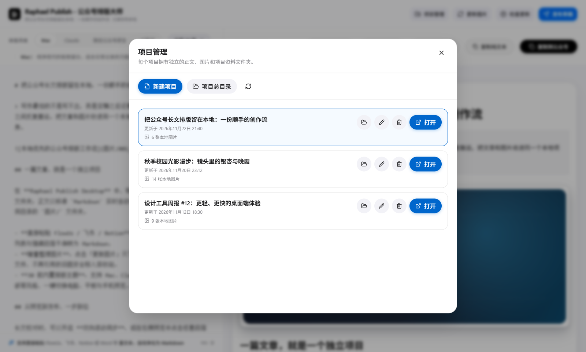
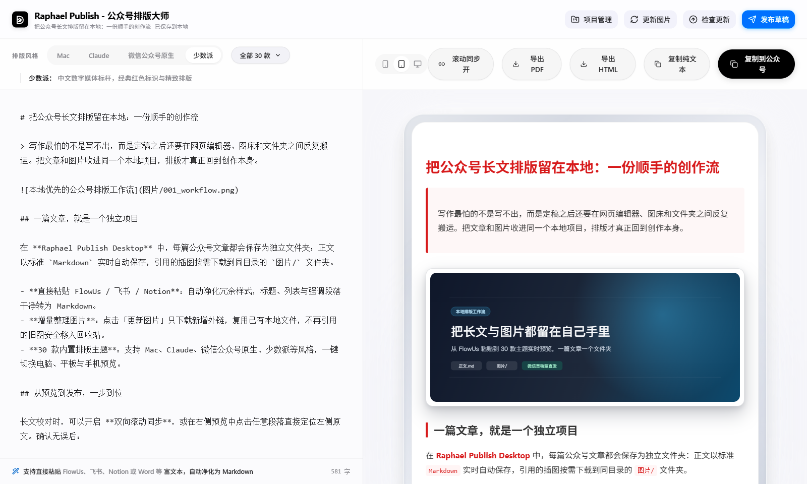
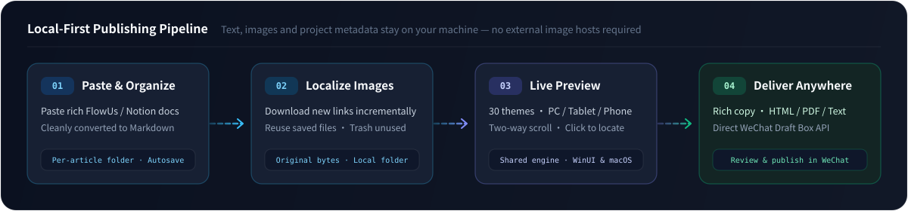

  <a href="README.md">简体中文</a> · <strong>English</strong>

  

  
  
  

  <strong><a href="https://github.com/DrivingGodJ/raphael-publish-desktop/releases/latest">Download Latest (Windows / macOS)</a></strong>
  &nbsp;·&nbsp;
  <a href="docs/INSTALL.md">Installation Guide (Chinese)</a>
  &nbsp;·&nbsp;
  <a href="docs/GUIDE.en.md">User &amp; Dev Guide</a>
  &nbsp;·&nbsp;
  <a href="https://github.com/DrivingGodJ/raphael-publish-desktop/issues">Issues</a>

> Take an article from collected notes and images to polished WeChat typesetting entirely on your machine. Paste content, localize images, compare 30 themes live, then copy, export or push to the WeChat Draft Box when ready.
>
> **Local-first guarantee**: Articles and original images stay in your own Documents folder and are never deleted on upgrade or uninstall. Draft publishing only creates drafts for manual review and never auto-publishes.

---

## Interface Preview

  <picture>
    <source media="(prefers-color-scheme: dark)" srcset="docs/assets/screenshot-webui-dark.png" />
    <source media="(prefers-color-scheme: light)" srcset="docs/assets/screenshot-webui-light.png" />
    
  </picture>
   
  <b>Desktop workspace (automatically adapts to GitHub light/dark mode)</b>: Live Markdown editing on the left, instant 30-theme WeChat preview on the right, with project management, image localization, in-app updates, and Draft API publishing along the top bar. Shown in Web UI; the native Windows WinUI 3 edition shares the exact same typesetting engine and project format.

<table>
  <tr>
    <td width="50%" align="center" valign="top">
      
       
      <b>Local project management</b>: One folder per article with automatic saving and local image counts.
    </td>
    <td width="50%" align="center" valign="top">
      
       
      <b>30 themes &amp; device widths</b>: Switch between desktop, tablet, and mobile reading widths anytime.
    </td>
  </tr>
</table>

---

## Key Capabilities

<table>
  <tr>
    <td width="50%" valign="top">
      <h3>✍️ Paste Rich Docs into Clean Markdown</h3>
      Paste entire FlowUs articles directly into the editor to convert headings, paragraphs, and emphasized callouts into clean Markdown. Every article lives in its own autosaved project folder.
    </td>
    <td width="50%" valign="top">
      <h3>🖼️ Incremental Local Image Sync</h3>
      Update images in one click to download newly added links while reusing existing local originals. Unreferenced images are safely moved to the Recycle Bin or Trash instead of cluttering your drive.
    </td>
  </tr>
  <tr>
    <td width="50%" valign="top">
      <h3>🎨 30 Built-in Themes &amp; Two-Way Sync</h3>
      Choose from 30 typography themes including Mac, Claude, WeChat Native, and sspai across desktop, tablet, and phone widths. Click preview paragraphs to jump to source and keep scrolling synchronized.
    </td>
    <td width="50%" valign="top">
      <h3>🚀 Copy, Export, or Push to WeChat Drafts</h3>
      Copy inline-styled rich content straight to WeChat, or export self-contained HTML, PDF, and plain text. With your own Official Account configured, upload original images and create drafts via the official API.
    </td>
  </tr>
  <tr>
    <td width="50%" valign="top">
      <h3>💻 Native Windows WinUI 3 &amp; macOS Editions</h3>
      Starting with v2.1.0, Windows ships exclusively as a lightweight native WinUI 3 app (with Mica backdrop and unused AI/ML dependencies trimmed); macOS ships dedicated Apple Silicon and Intel Web UI builds.
    </td>
    <td width="50%" valign="top">
      <h3>🔄 Silent Update Checks &amp; One-Click Upgrade</h3>
      Silently checks GitHub Releases on launch with zero interruption when up to date or offline. When a newer release is available, download, verify SHA-256 checksums, install, and relaunch right from the app.
    </td>
  </tr>
</table>

---

## Local Workflow

   Localize Images -> Live Preview -> Deliver Anywhere" width="100%" />

> [!NOTE]
> **Shared project format & local privacy**: Both Windows (WinUI 3) and macOS (Web UI) use the same on-disk project layout (`正文.md`, `project.json`, `图片/`) under `Documents/Raphael公众号项目`. Official Account credentials are encrypted locally via OS-native storage (Windows DPAPI / macOS Keychain) and sent only to WeChat's official API.

---

## Quick Start

1. **Download & install**: Grab the latest installer from [Releases](https://github.com/DrivingGodJ/raphael-publish-desktop/releases/latest) — `WinUI Setup.exe` for Windows x64, or `macos-arm64.dmg` / `macos-x64.dmg` for macOS.
2. **Create a project & sync images**: Paste your FlowUs or Markdown article, then run **Update Images** to download and co-locate all images inside the project folder.
3. **Preview & deliver**: Pick a theme and preview width, then click **Copy to WeChat** or **Publish Draft** to finish.

System requirements & verification notes

- **Windows**: Requires Windows 10 2004 (build 19041) or later on x64. Bundles .NET and required WinUI components, and installs WebView2 Runtime via Microsoft's signed bootstrapper if absent.
- **macOS**: Requires macOS 13 Ventura or later with native Apple Silicon (`arm64`) and Intel (`x64`) disk images.
- **Checksums & signing**: Every release includes `SHA256SUMS.txt`. Installers are currently unsigned and unnotarized — see the [installation guide (Chinese)](docs/INSTALL.md) for verification steps.

---

## Explore Further

| Topic | Documentation |
| :--- | :--- |
| Installation, upgrades, removal & checksums | [Installation guide (Chinese)](docs/INSTALL.md) |
| Articles, projects & interface usage | [Web UI](LOCAL-README.en.md) · [WinUI](native/README.en.md) |
| Windows native lightweight architecture | [Windows architecture (Chinese)](docs/WINDOWS-ARCHITECTURE.md) |
| Draft API, credentials, builds & checks | [User & development guide](docs/GUIDE.en.md) |
| Feedback & bug reports | [GitHub Issues](https://github.com/DrivingGodJ/raphael-publish-desktop/issues) |

---

A community desktop adaptation of [Raphael Publish](https://github.com/liuxiaopai-ai/raphael-publish). Licensed under the [MIT License](LICENSE) · See [Origins and third-party notices](NOTICE.md).
