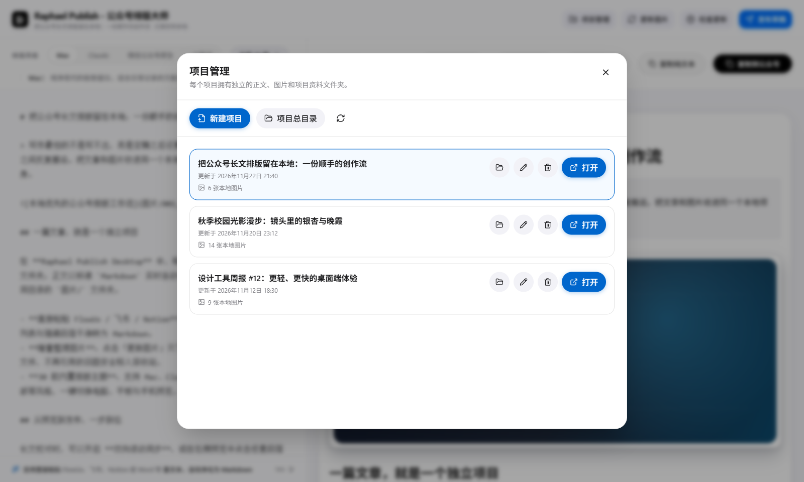

  <strong>简体中文</strong> · <a href="README.en.md">English</a>

  

  
  
  

  <strong><a href="https://github.com/DrivingGodJ/raphael-publish-desktop/releases/latest">下载最新版（Windows / macOS）</a></strong>
  &nbsp;·&nbsp;
  <a href="docs/INSTALL.md">安装指南</a>
  &nbsp;·&nbsp;
  <a href="docs/GUIDE.zh-CN.md">使用与开发指南</a>
  &nbsp;·&nbsp;
  <a href="https://github.com/DrivingGodJ/raphael-publish-desktop/issues">问题反馈</a>

> 把一篇文章，从内容整理、图片归档到公众号排版都安稳留在本地。粘贴正文、整理图片、切换 30 款主题实时预览，看到满意的效果后再一键复制、导出或直发微信草稿箱。
>
> **本地优先承诺**：正文与原图始终保存在你自己的文档目录，升级与卸载均不删除文章项目；直发草稿箱仅创建草稿，绝不自动发表。

---

## 界面一览

  <picture>
    <source media="(prefers-color-scheme: dark)" srcset="docs/assets/screenshot-webui-dark.png" />
    <source media="(prefers-color-scheme: light)" srcset="docs/assets/screenshot-webui-light.png" />
    
  </picture>
   
  <b>桌面版主界面实拍（随 GitHub 深浅色主题自动切换）</b>：左侧 Markdown 实时编辑，右侧 30 款公众号主题即时预览，顶部集成项目管理、图片更新、检查更新与草稿箱发布。图为 Web UI 桌面版，Windows 原生 WinUI 3 版共享同一套排版引擎与项目格式。

<table>
  <tr>
    <td width="50%" align="center" valign="top">
      
       
      <b>本地项目管理</b>：一篇文章对应一个独立文件夹，自动保存正文并记录本地图片数量。
    </td>
    <td width="50%" align="center" valign="top">
      
       
      <b>多主题与设备预览</b>：内置 30 款风格，随时切换电脑、平板与手机阅读宽度。
    </td>
  </tr>
</table>

---

## 核心体验

<table>
  <tr>
    <td width="50%" valign="top">
      <h3>✍️ 粘贴即写，独立项目自动保存</h3>
      把 FlowUs 等富文本整篇粘贴进编辑器，标题、正文与强调段落自动净化为标准 Markdown。每篇文章单独成项，修改即自动保存，随时回来接着打磨。
    </td>
    <td width="50%" valign="top">
      <h3>🖼️ 图片跟着文章走，增量同步</h3>
      点击“<b>更新图片</b>”，仅下载文章中新加入的外链图片并复用已有本地原图；不再引用的旧图安全移入回收站或废纸篓，告别散乱图床与失效链接。
    </td>
  </tr>
  <tr>
    <td width="50%" valign="top">
      <h3>🎨 30 款排版主题与双向同步</h3>
      涵盖 Mac、Claude、微信公众号原生、少数派等 30 款主题，支持电脑 / 平板 / 手机宽度切换。支持点击预览段落定位原文以及双向滚动同步，校对长文更从容。
    </td>
    <td width="50%" valign="top">
      <h3>🚀 复制、导出与草稿箱直发</h3>
      一键复制带样式正文与图片粘贴到公众号后台，也支持导出 HTML、PDF 与纯文本；配置自己的公众号开发凭据后，可通过官方接口直传原图创建草稿。
    </td>
  </tr>
  <tr>
    <td width="50%" valign="top">
      <h3>💻 Windows 原生 WinUI 3 与 macOS 双版</h3>
      从 v2.1.0 起，Windows 仅发行轻量原生 WinUI 3 版（支持 Mica 背景，按需裁剪无关 AI/ML 依赖）；macOS 提供 Apple Silicon 与 Intel 双架构 Web UI。
    </td>
    <td width="50%" valign="top">
      <h3>🔄 静默检查更新与一键升级</h3>
      每次启动在后台静默检查 GitHub Releases，无新版本或离线时完全不打扰；发现新版本后自动提示，点击即可下载、校验 SHA-256 并自动完成更新重启。
    </td>
  </tr>
</table>

---

## 本地工作流

  

> [!NOTE]
> **平台与数据目录说明**：Windows（WinUI 3）与 macOS（Web UI）共用同一套本地项目结构（`正文.md`、`project.json`、`图片/`），默认存放在文档目录的 `Raphael公众号项目` 中。公众号凭据仅通过系统本机加密保存（Windows DPAPI / macOS Keychain），不经过任何第三方中转。

---

## 快速上手

1. **下载安装**：前往 [Releases 页面](https://github.com/DrivingGodJ/raphael-publish-desktop/releases/latest)，Windows x64 下载 `WinUI Setup.exe`，macOS 按芯片选择 `macos-arm64.dmg` 或 `macos-x64.dmg`。
2. **新建项目并整理图片**：打开应用新建文章项目，粘贴 FlowUs 或 Markdown 正文，点击“**更新图片**”将外链图片全部归档到本地项目文件夹。
3. **选定主题并交付**：在 30 款主题与多设备预览中确认版式，点击“**复制到公众号**”或“**发布草稿**”完成交付。

查看版本选择与安装注意事项

- **Windows**：需要 Windows 10 2004（19041）或更新版本（x64），安装包内置 .NET 与必要 WinUI 运行库，缺失 WebView2 Runtime 时会自动调用微软签名引导程序安装。
- **macOS**：需要 macOS 13 Ventura 或更新版本，提供 Apple Silicon（`arm64`）与 Intel（`x64`）独立镜像。
- **校验与信任**：每个 Release 均附带 `SHA256SUMS.txt`；当前安装包尚未进行代码签名与 Apple 公证，详细安装与校验步骤请参阅 [安装指南](docs/INSTALL.md)。

---

## 进一步了解

| 想了解什么 | 去哪里看 |
| :--- | :--- |
| 安装、升级、卸载与哈希校验 | [安装指南](docs/INSTALL.md) |
| 文章项目与界面操作细节 | [Web UI 使用说明](LOCAL-README.md) · [WinUI 使用说明](native/README.md) |
| Windows 原生轻量架构说明 | [Windows 原生轻量架构](docs/WINDOWS-ARCHITECTURE.md) |
| 草稿接口、数据安全与源码构建 | [使用与开发指南](docs/GUIDE.zh-CN.md) |
| 问题反馈与建议 | [GitHub Issues](https://github.com/DrivingGodJ/raphael-publish-desktop/issues) |

---

基于 [Raphael Publish](https://github.com/liuxiaopai-ai/raphael-publish) 的社区桌面改造。遵循 [MIT License](LICENSE) 开源 · 查看 [来源与第三方许可声明](NOTICE.md)。
